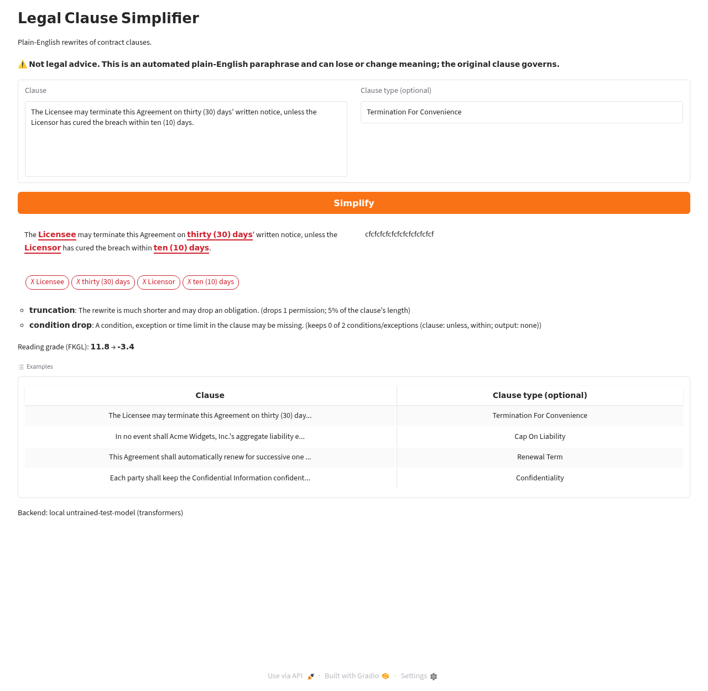
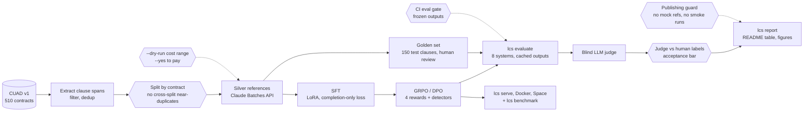

# Legal Clause Simplifier

Post-training a 0.8B open model to rewrite contract clauses in plain English without dropping a party, an amount, a deadline or an "unless".

[](https://github.com/erfunm/Legal-Clause-Simplifier-using-RLHF/actions/workflows/ci.yml)
[](LICENSE)
[](pyproject.toml)


## What this is

- **SFT → GRPO / DPO on Qwen3.5-0.8B** (LoRA) with a 4-part verifiable reward: meaning (NLI), simplicity (SARI and a reading-grade band), entity preservation, and format. Each part is logged on its own.
- **Reward-hacking detectors** for truncation, verbatim copying, entity word salad, must/may/must-not flips and dropped conditions. They penalise the reward, keep hacks out of DPO's preferred answers, and scan saved outputs.
- **A blind LLM judge validated against human labels**, with an acceptance bar fixed before any labelling and an open-weight second judge as a self-preference check.
- **A CI eval gate and a serving stack**: frozen-output regression checks in CI, a FastAPI service with streaming and per-request warnings, CPU and GPU (vLLM) Docker images, and a Gradio demo for a Hugging Face Space.

## Results

<!-- results:start -->
No model has been trained on real data yet, so there are no metrics here. `lcs report` fills this section from a real evaluation run, after the steps in [docs/RUNBOOK.md](docs/RUNBOOK.md). It refuses smoke runs and mock references, so nothing placeholder can appear.
<!-- results:end -->



*UI only, untrained test model. The rewrite is noise from a 5M-parameter random model. The screenshot shows the layout: entities in red when missing, detector warnings, reading grade before and after.*

## How it works



The hexagons are gates. A run fails or refuses there instead of producing something misleading:

- **Contract split:** no contract spans two splits, and no dev/test clause near-duplicates a train clause ([ADR-007](docs/decisions.md#adr-007-near-duplicate-removal-and-contract-level-splits)).
- **Paid calls:** every paid API stage prints a cost range on `--dry-run` and refuses without `--yes` ([ADR-015](docs/decisions.md#adr-015-reference-pilot-and-dry-run-cost-estimates)).
- **Judge validation:** judge scores reach the headline table only after they agree with human labels ([ADR-026](docs/decisions.md#adr-026-judge-validation-by-human-labels)).
- **Publishing:** `lcs report` and `lcs push-dataset` refuse smoke runs and mock references ([ADR-006](docs/decisions.md#adr-006-every-record-carries-reference_source-mock-data-can-never-be-published)).
- **CI eval gate:** fails the build if the scoring code regresses ([ADR-027](docs/decisions.md#adr-027-error-analysis-report-and-the-ci-eval-gate)).

## Reward design and reward hacking

GRPO gets four reward functions, logged separately as `rewards/<name>/mean`. DPO pair ranking and evaluation use the same functions with the same weights ([ADR-018](docs/decisions.md#adr-018-four-reward-functions-logged-separately-shared-by-grpo-dpo-and-evaluation)).

| reward | range | what it measures |
|---|---|---|
| `meaning` | 0–1 | NLI P(entailment) of clause → rewrite (DeBERTa-v3 cross-encoder). Options: `nli_coverage` (reverse, per clause part) or BERTScore |
| `simplicity` | 0–1 | SARI against the reference, averaged with an FKGL band (grade 5–9) whose lower edge stops choppy text from scoring well |
| `entity_preservation` | 0–1 | share of parties, dates, amounts, durations and defined terms kept; formats are normalised, so "$1,000,000" = "$1 million" = "one million dollars" |
| `format` | −1–0 | −1 for empty output; penalties for runaway length (more than 1.6× the clause) and for each detector below |

**Detectors** ([ADR-020](docs/decisions.md#adr-020-reward-hacking-detectors)). The examples are **hand-written test cases from `tests/test_hacking.py`, not model outputs**:

| detector | test-case clause (excerpt) | test-case rewrite | why it fires | `format` penalty |
|---|---|---|---|---|
| `truncation` | "The Distributor shall purchase at least 10,000 units each calendar year and shall not sell competing products in the Territory. The Supplier may terminate…" | "The Distributor buys units in the Territory." | drops an obligation, a prohibition and a permission while under half the length (or averaging < 5 words per sentence) | 0.5 |
| `verbatim_copy` | same clause | the clause with "shall purchase" → "shall buy" and "thirty (30)" → "30" | ≥ 85% of its word 4-grams are copied | 1.0 |
| `word_salad` | same clause | "The Distributor, 10,000, the Territory, the Supplier, thirty (30) days." | 5 entities and almost nothing else | 1.0 |
| `modality_flip` | "…must not sell competing products in the Territory…" (rewrite of the clause above) | "…may sell competing products in the Territory…" | a prohibition lost its negation (also must → may, may → must, added prohibitions) | 0.5 |
| `condition_drop` | "The Licensee may terminate on 30 days' notice, unless the Licensor has cured the breach within 10 days." | "The Licensee can end this agreement with 30 days' notice." | keeps 0 of 2 conditions ("unless", "within") | 0.5 |

On top of the penalty, a flagged sample is never chosen as the preferred answer in a DPO pair, and `lcs detect-hacking` / `lcs error-analysis` count each detector per system.

**The `condition_drop` story.** Clause → rewrite NLI only checks that the rewrite adds nothing. A rewrite that *deletes* an exception is still fully entailed. In the example above it keeps the permission (so `truncation` and `modality_flip` stay silent), and it scores better on simplicity because it is shorter. GRPO would learn to delete exceptions. Entity recall catches this only when the exception names its own entities ("10 days", "the Licensor"); "…unless the breach has been cured" passes every other check. Two fixes ([ADR-018](docs/decisions.md#adr-018-four-reward-functions-logged-separately-shared-by-grpo-dpo-and-evaluation)):

1. The `condition_drop` detector counts condition, exception and time-limit markers on both sides, including plain-English equivalents ("but not if", "in 10 days"), and is on by default.
2. A `meaning.method: nli_coverage` variant splits the clause into sentences and conditional parts, and scores how well the rewrite entails each one. Whether coverage also punishes legitimate compression is measured by the `ablation-meaning-coverage` run, not assumed.

The same fixtures caught two `modality_flip` false positives: modal verbs inside a condition ("…notice that it will not renew") were counted as main statements. They are fixed, and both are now regression tests.

## Engineering decisions

All 31 decisions are in [docs/decisions.md](docs/decisions.md). Eight that shaped the project:

- **GRPO over PPO:** no value model to fit in memory next to a 248k vocabulary, verifiable rewards suited to group-relative advantages, and PPO is gone from TRL 1.x ([ADR-031](docs/decisions.md#adr-031-grpo-replaces-ppo)).
- **Split by contract, then remove near-duplicates:** CUAD contracts reuse boilerplate, so a clause-level split would leak test clauses into training ([ADR-007](docs/decisions.md#adr-007-near-duplicate-removal-and-contract-level-splits)).
- **The frozen SFT adapter as the KL reference:** GRPO and DPO keep training the SFT LoRA adapter. TRL's frozen copy of it is the reference, so the KL pulls towards SFT, not the raw base, and no second model is loaded ([ADR-019](docs/decisions.md#adr-019-grpo-and-dpo-continue-the-sft-adapter-the-reference-is-a-frozen-copy-of-it)).
- **Own SARI, cross-checked against HF `evaluate`:** both agree on 10 examples, and the tests pin down where they differ (HF scores an empty keep/delete/add set as 1, ours as 0), so the numbers can be compared with published ones ([ADR-003](docs/decisions.md#adr-003-sari-is-implemented-in-the-package-not-taken-from-easse)).
- **A blind judge with a self-preference check:** outputs are shuffled under letters with no system names. Claude writes the references and is one of the systems, so an open-weight judge from another family runs as a cross-check ([ADR-025](docs/decisions.md#adr-025-llm-judge-blinding-and-self-preference)).
- **The judge acceptance bar was set before labelling:** QWK and Spearman ≥ 0.6, each with a 95% CI lower bound ≥ 0.4, per criterion. Criteria that fail are reported separately as not validated ([ADR-026](docs/decisions.md#adr-026-judge-validation-by-human-labels)).
- **Inference extras separate from training:** vLLM pins torch and transformers versions the training stack cannot use, so serving installs `infer` + `serve` only and falls back to transformers if vLLM cannot load the model ([ADR-028](docs/decisions.md#adr-028-serving-fastapi-service-and-engines)).
- **Mock data can never be published:** every record carries `reference_source`. The dataset push and the report refuse mock references and smoke runs, so offline CI data cannot reach the README ([ADR-006](docs/decisions.md#adr-006-every-record-carries-reference_source-mock-data-can-never-be-published)).

## Evaluation methodology

- **Systems (8):** copy-the-input and truncate (lower bounds), base model zero-shot and few-shot, SFT, SFT+DPO, SFT+GRPO, and Claude zero-shot (upper reference, same prompt as the student). Each is a small class, and generations are cached by a fingerprint that includes a hash of the adapter weights, so re-scoring never re-generates ([ADR-023](docs/decisions.md#adr-023-evaluation-harness-systems-cache-and-run-format)).
- **Data:** the 150-clause golden set (with its review status) and optionally a dev sample.
- **Metrics:** SARI, BERTScore, FKGL, entity recall, NLI faithfulness (clause → output) and coverage (each clause part ← output), the hallucination rate, the compression ratio, and the rate of each detector. The judge scores four criteria from 1–5, with rationales and quotes checked to appear word for word ([ADR-024](docs/decisions.md#adr-024-metrics-and-statistics)).
- **Statistics:** 95% bootstrap CIs for every mean. Each trained system is tested against SFT on the same clauses: a bootstrap CI on the difference plus a sign-flip permutation p-value. Systems that share a group (training seeds) also get mean ± std.
- **Judge validation:** 50–100 outputs labelled blind on the same rubric, then Spearman and quadratic-weighted κ with CIs that resample outputs, checked against the acceptance bar.
- **Error taxonomy:** each failed output is assigned to detector types, metric thresholds and low judge criteria, with counts per system and sampled examples ([ADR-027](docs/decisions.md#adr-027-error-analysis-report-and-the-ci-eval-gate)).
- **Eval gate:** a CI job re-scores 20 frozen, clearly labelled mock outputs and fails if entity recall, the condition-drop or modality-flip rate, or a judge-proxy score leaves its range. A deliberately degraded copy of the fixture proves it fails.

## Quickstart (CPU, about 5 minutes)

```bash
uv sync --all-extras
make test smoke          # unit tests, then data -> SFT -> GRPO -> DPO -> eval -> judge (proxy) -> benchmark
                         # on fixture data and tiny random models; the outputs are not results

uv run lcs serve --config configs/smoke/serve.yaml      # serves the tiny model trained by `make smoke`
curl -s localhost:8000/simplify -H 'content-type: application/json' \
  -d '{"clause": "The Licensee may terminate on 30 days notice, unless the breach is cured within 10 days."}'

# The same in Docker (the model is mounted from ./checkpoints, not baked into the image):
docker compose run --rm --service-ports api lcs serve --config configs/smoke/serve.yaml --host 0.0.0.0
```

The response includes the rewrite, each entity with `kept: true/false`, detector `warnings`, the reading grade before and after, token usage and a request id. `GET /health` and `POST /simplify/stream` (SSE) are also served. Run `uv run lcs --help` for all 23 commands.

## Reproduce the real run

[docs/RUNBOOK.md](docs/RUNBOOK.md) lists every command, in order, that needs an account, money, a GPU or a person:

1. [Data and references](docs/RUNBOOK.md#1-data-and-references): extract CUAD, then a ~20-clause paid pilot, then the full silver-reference run, then the golden-set review (a person).
2. [SFT](docs/RUNBOOK.md#2-supervised-fine-tuning): Modal, Colab/Kaggle, or any CUDA machine.
3. [GRPO, DPO and ablations](docs/RUNBOOK.md#3-rl-post-training-grpo-dpo-and-ablations).
4. [Evaluation, judge and report](docs/RUNBOOK.md#4-evaluation-the-judge-and-the-report): the free systems on the GPU, then the Claude system and judge (paid), then labelling 50–100 outputs (a person), then `lcs report`.
5. [Serving, demo and benchmark](docs/RUNBOOK.md#5-serving-the-demo-and-the-benchmark): Docker, the L4 benchmark, and publishing the Space only when you decide to.

**Hardware:** one 24 GB GPU (NVIDIA L4) for every GPU stage. Modal scripts and Colab/Kaggle notebooks are included, and nothing needs more than one GPU.

**API cost (estimate, not spend):** the offline dry run for the silver references on the 3,389 extracted clauses prints **$2.00 to $72.75** at Batch prices. Input tokens are counted locally, and output ranges from a rewrite-only floor to the `max_tokens` ceiling. The ~20-clause pilot narrows that range before the full run. The Claude evaluation system and the judge print their own ranges with `--dry-run` once evaluation outputs exist.

## Project structure

```
src/legal_simplifier/
├── cli.py            # `lcs` entry point (Typer), 23 commands
├── config.py         # typed configs (pydantic, extra="forbid"), one YAML per stage
├── prompts.py        # the one prompt used by training, evaluation and serving
├── data/             # CUAD extraction, entities, dedup + contract split, references, golden set, review tool, dataset card
├── llm/              # Claude Batches runner (cache, resume, cost log) and dry-run cost estimates
├── rewards/          # SARI, NLI, BERTScore, FKGL band, entities, format; reward-hacking detectors; the reward suite
├── training/         # SFT (LoRA/QLoRA), GRPO, DPO pairs + training, ablations, tracking, model cards
├── eval/             # systems, metrics, statistics, judge, labels + agreement, error analysis, report, gate, guards
└── serving/          # FastAPI app, engines (transformers / vLLM), analysis, Gradio demo, benchmark
configs/              # one YAML per stage; configs/smoke/ for tiny CPU runs; configs/ablations/
scripts/              # Modal scripts for each GPU stage (one L4)
notebooks/            # Colab/Kaggle notebooks for SFT, GRPO/DPO and evaluation
docker/               # CPU and GPU serving images (docker-compose.yml at the root)
space/                # Hugging Face Space app and README (not pushed)
tests/                # 405 tests (33 on tiny models); fixtures are synthetic or hand-written
docs/                 # decisions (ADRs), runbook, figures
```

## Limitations and responsible use

- **Not legal advice.** The model paraphrases. It can lose or change meaning, and the original clause governs. The API response and the demo say so.
- **English, mostly US commercial contracts.** CUAD's contracts are SEC filings, so other jurisdictions, languages and contract types are out of scope.
- **Silver-label bias.** Training references are written by a Claude model (`claude-sonnet-5-5`), and only the 150-clause golden set is human-checked. Reference metrics such as SARI and BERTScore reward imitating that writer, which favours the Claude system in the comparison.
- **Judge limits.** The primary judge is also Claude (`claude-opus-5-5`), so it may prefer Claude-like text. Its criteria count only once they pass the human-agreement bar. 50–100 labels from one reviewer give wide intervals, and the open-weight cross-check is a second opinion, not ground truth.
- **Known detector misses.** The detectors are surface heuristics:
  - A fluent paraphrase that changes meaning gets past them; NLI and the judge are the backstop.
  - A condition rephrased with no marker ("subject to Section 5" → "Section 5 applies") fires `condition_drop` falsely, and a dropped condition replaced by an unrelated "if" does not fire.
  - A must/may flip *inside* a proviso is no longer `modality_flip`'s to catch.
  - Entity extraction is regex-based and misses some terms; "one and a half million" is not normalised.
- **No real-run results yet.** Every number in this README is a count of code, tests or data, or a labelled estimate.

## License and citations

Code: [MIT](LICENSE). Data derived from CUAD is CC BY 4.0, like CUAD. The base model Qwen3.5-0.8B is Apache-2.0.

- **CUAD:** Hendrycks, Burns, Chen, Ball. *CUAD: An Expert-Annotated NLP Dataset for Legal Contract Review.* NeurIPS 2021 Datasets and Benchmarks. [arXiv:2103.06268](https://arxiv.org/abs/2103.06268)
- **TRL:** von Werra et al. *TRL: Transformer Reinforcement Learning.* [github.com/huggingface/trl](https://github.com/huggingface/trl)
- **Qwen3.5-0.8B:** Qwen Team. [huggingface.co/Qwen/Qwen3.5-0.8B](https://huggingface.co/Qwen/Qwen3.5-0.8B); *Qwen3 Technical Report*, [arXiv:2505.09388](https://arxiv.org/abs/2505.09388)
- **GRPO:** Shao et al. *DeepSeekMath: Pushing the Limits of Mathematical Reasoning in Open Language Models.* [arXiv:2402.03300](https://arxiv.org/abs/2402.03300)
- **DAPO** (the GRPO loss used): Yu et al. *DAPO: An Open-Source LLM Reinforcement Learning System at Scale.* [arXiv:2503.14476](https://arxiv.org/abs/2503.14476)
- **DPO:** Rafailov et al. *Direct Preference Optimization: Your Language Model is Secretly a Reward Model.* NeurIPS 2023. [arXiv:2305.18290](https://arxiv.org/abs/2305.18290)
- **The 2-vs-8 generations ablation:** *It Takes Two: Your GRPO Is Secretly DPO.* NeurIPS 2025.
- **LoRA:** Hu et al. [arXiv:2106.09685](https://arxiv.org/abs/2106.09685). **QLoRA:** Dettmers et al. [arXiv:2305.14314](https://arxiv.org/abs/2305.14314)
- **SARI:** Xu, Napoles, Pavlick, Chen, Callison-Burch. *Optimizing Statistical Machine Translation for Text Simplification.* TACL 2016.
- **BERTScore:** Zhang et al. ICLR 2020. [arXiv:1904.09675](https://arxiv.org/abs/1904.09675)
- **The NLI model:** `cross-encoder/nli-deberta-v3-base`, on DeBERTaV3 (He et al. [arXiv:2111.09543](https://arxiv.org/abs/2111.09543))
